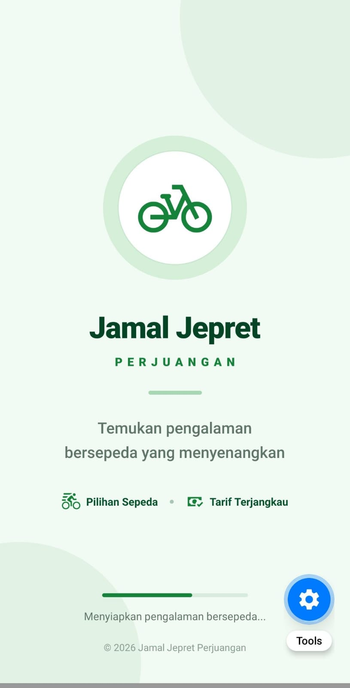
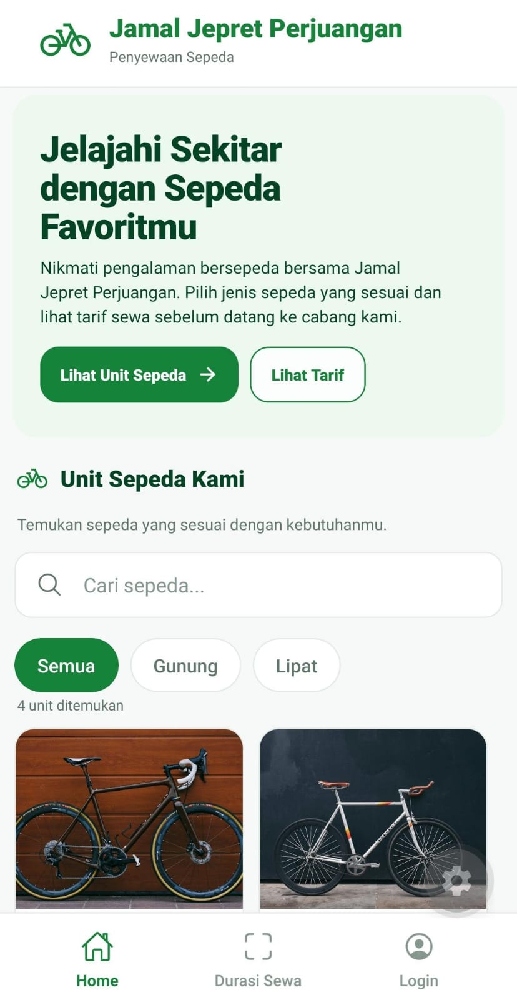
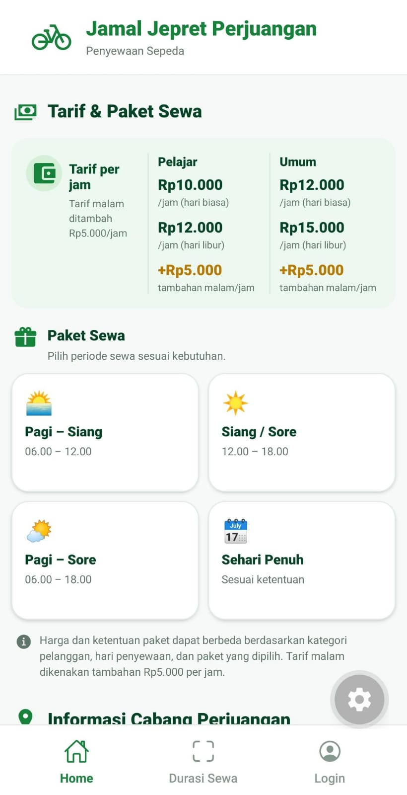
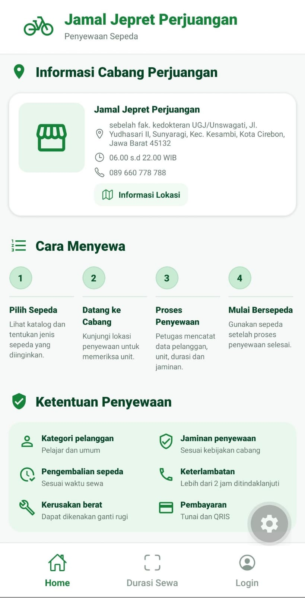
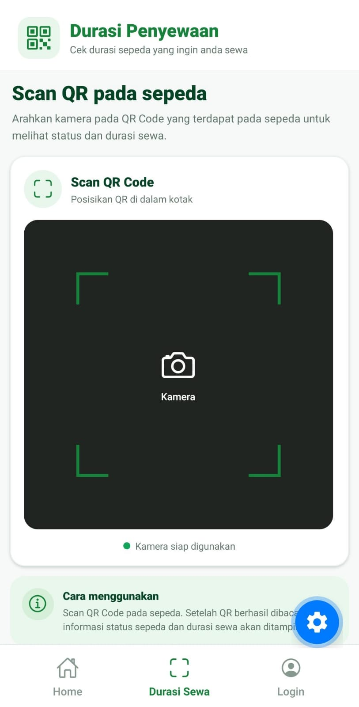
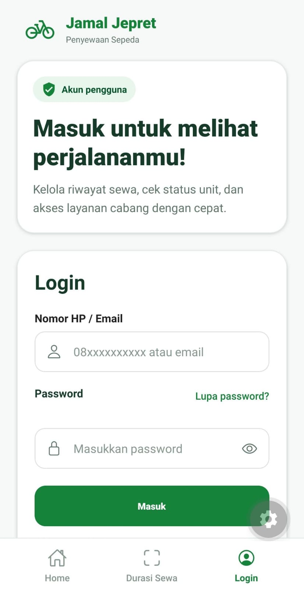
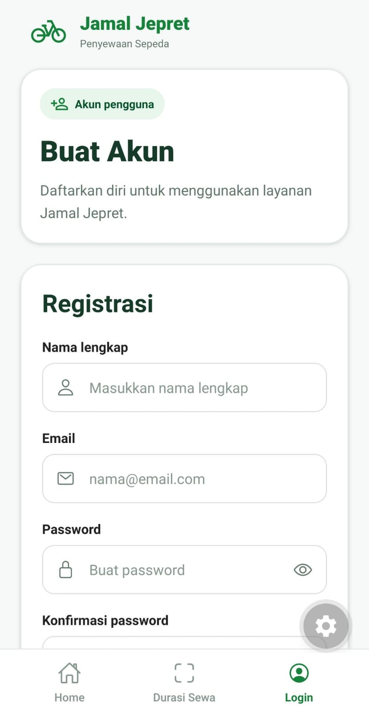

# Penyewaan Sepeda Jamal Jepret

## Deskripsi Aplikasi

Aplikasi Penyewaan Sepeda Jamal Jepret merupakan aplikasi mobile yang dirancang untuk memudahkan pelanggan dalam memperoleh informasi penyewaan sepeda serta membantu pengelola dalam mengatur operasional penyewaan. Aplikasi ini memiliki tiga jenis akses, yaitu Public, User, dan Admin. Public dapat melihat katalog, harga, dan ketersediaan sepeda tanpa login. User dapat mengakses fitur tersebut setelah login serta melihat riwayat penyewaan pribadi. Sementara itu, Admin memiliki akses untuk mengelola data sepeda dan pengguna, mencatat transaksi penyewaan dan pengembalian, memantau status sepeda, serta mengelola laporan operasional. Aplikasi ini diharapkan dapat membuat proses penyewaan lebih teratur, efisien, dan mudah dipantau.

# Daftar Screen

### 1. Splash Screen

Halaman pembuka yang menampilkan identitas aplikasi dan indikator loading sebelum pengguna masuk ke halaman utama.

### 2. Home
Halaman utama yang menampilkan katalog sepeda, tarif dan paket sewa, serta informasi cabang dan ketentuan penyewaan. Halaman ini membantu pengguna menemukan sepeda yang sesuai, memahami biaya sewa, dan mengetahui prosedur penyewaan sebelum menyewa.

 

 

### 3. Durasi Sewa

Halaman untuk memindai QR Code pada sepeda agar pengguna dapat melihat status sepeda dan informasi durasi penyewaan.

### 4. Login

Halaman untuk pengguna masuk ke akun menggunakan nomor HP atau email dan password agar dapat mengakses fitur khusus pengguna, seperti riwayat penyewaan.

### 5. Registrasi

Halaman untuk pengguna baru membuat akun dengan mengisi nama lengkap, email, password, dan konfirmasi password agar dapat mengakses fitur khusus pengguna.

# Cara Menjalankan Proyek

1. Clone repository

    https://github.com/nazwahummaimah/ProjectKelompok1_PMOB.git
2. Masuk ke direktori proyek

    cd ProjectKelompok1_PMOB
3. Instal dependensi

    npm install
4. Jalankan aplikasi

    npx expo start
5. Buka aplikasi

    Setelah aplikasi berjalan, pengguna dapat mengaksesnya melalui Expo Go dengan memindai QR Code, emulator Android, atau browser web.

