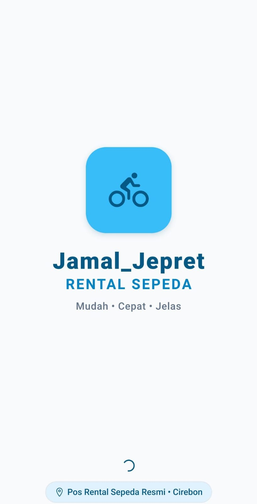
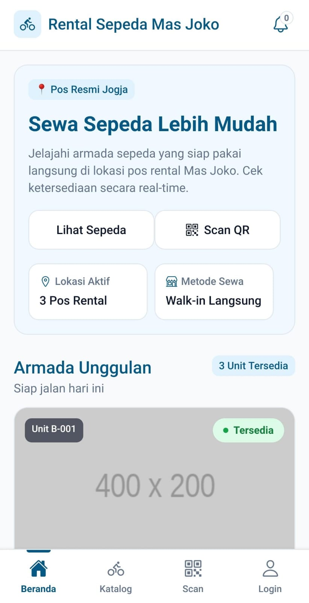
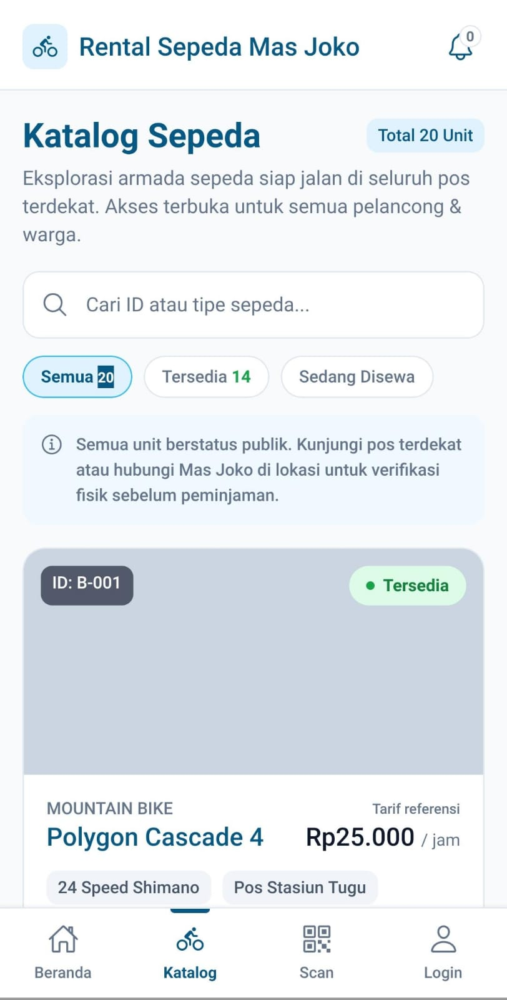
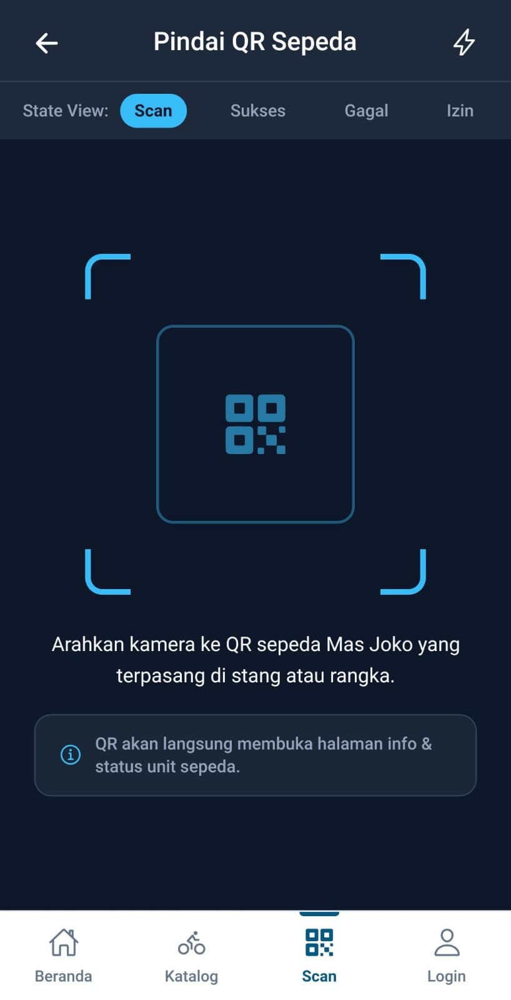
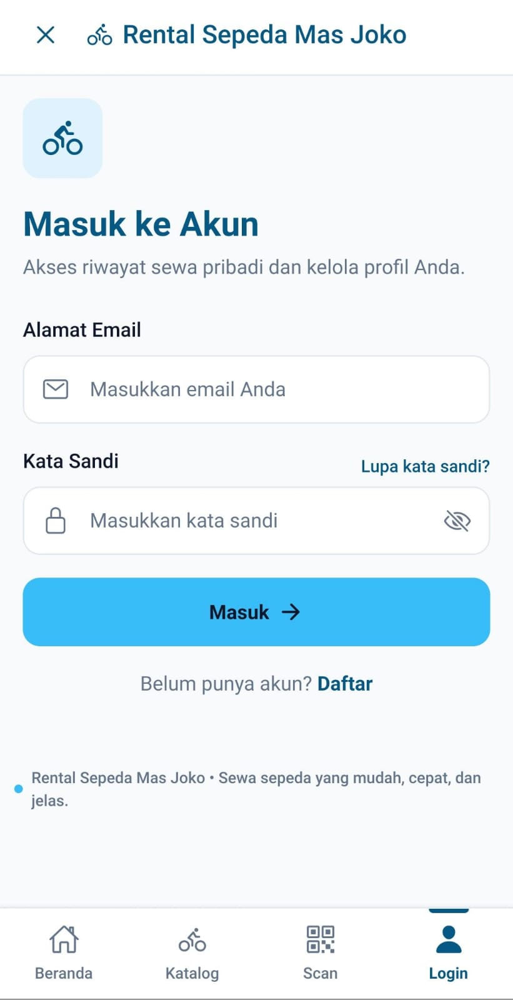
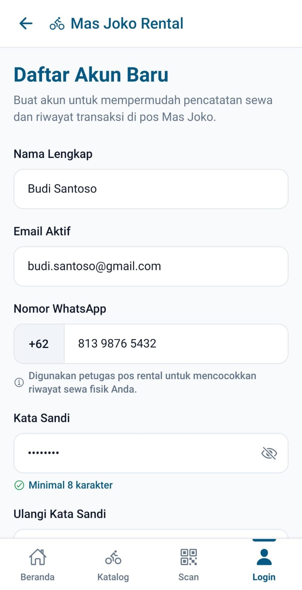
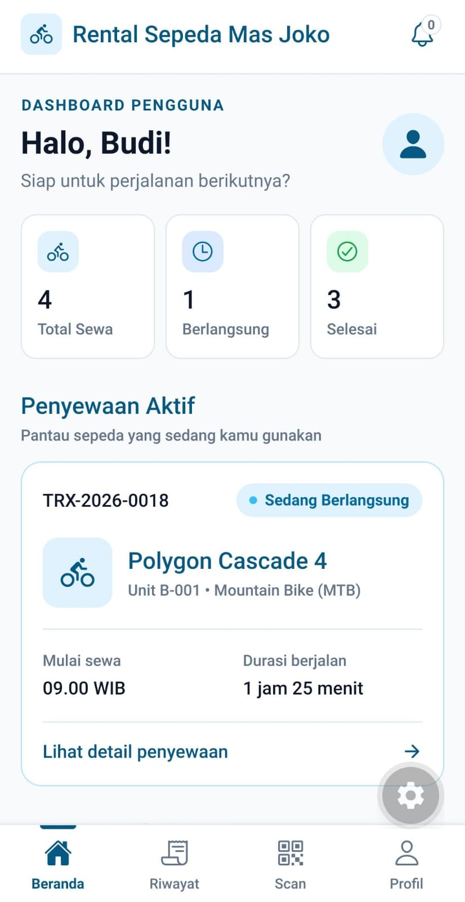
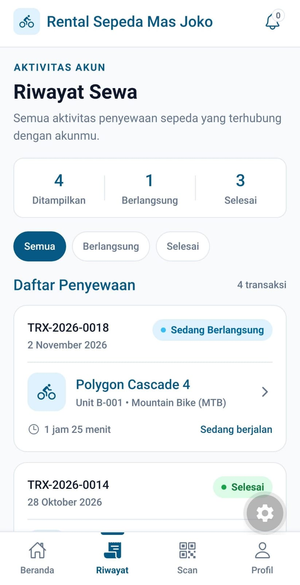
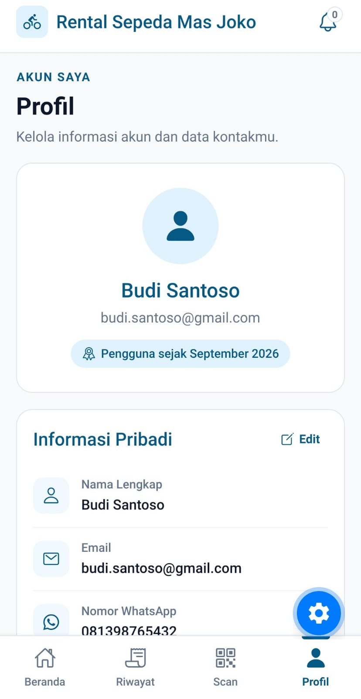

# Penyewaan Sepeda Jamal Jepret

## Deskripsi Aplikasi

Aplikasi Penyewaan Sepeda Jamal Jepret merupakan aplikasi mobile yang dirancang untuk memudahkan pelanggan dalam memperoleh informasi penyewaan sepeda serta membantu pengelola dalam mengatur operasional penyewaan. Aplikasi ini memiliki tiga jenis akses, yaitu Public, User, dan Admin. Aplikasi ini diharapkan dapat membuat proses penyewaan lebih teratur, efisien, dan mudah dipantau.

### Fitur Aplikasi
- Public: Melihat beranda, katalog, tarif, dan ketersediaan sepeda.

- User: Registrasi, login, scan QR Code, dashboard, riwayat sewa, dan profil.

- Admin: Mengelola inventaris, transaksi penyewaan, dan laporan.

# Daftar Screen dan Fitur

### 1. Splash Screen

 Menampilkan logo dan identitas aplikasi sebelum pengguna masuk ke halaman utama.

### 2. Beranda (Public)
 Menampilkan informasi rental, lokasi rental, metode penyewaan, dan armada sepeda unggulan.

### 3. Katalog Sepeda
 Menampilkan daftar sepeda, pencarian berdasarkan ID atau tipe, filter status, tarif, spesifikasi, dan lokasi unit.

### 4. Sca4n QR Code
 Memindai QR Code untuk mengenali ID sepeda serta melihat status dan durasi sewa.

### 5. Login
 Menyediakan halaman masuk menggunakan email dan kata sandi.

### 6. Registrasi 
 Menyediakan halaman pendaftaran akun baru dengan mengisi data pengguna.

### 7. Beranda User
 Menampilkan ringkasan aktivitas dan informasi penyewaan aktif.

### 8. Riwayat Sewa
 Menampilkan daftar transaksi penyewaan berdasarkan status berlangsung dan selesai

### 9. Profil Pengguna
 Menampilkan informasi akun pengguna seperti nama, email, dan nomor WhatsApp.

<table>
  <tr>
    <th>Splash Screen</th>
    <th>Beranda</th>
    <th>Katalog</th>
  </tr>
  <tr>
    <td align="center"></td>
    <td align="center"></td>
    <td align="center"></td>
  </tr>
  <tr>
    <th>Scan QR Code</th>
    <th>Login</th>
    <th>Registrasi</th>
  </tr>
  <tr>
    <td align="center"></td>
    <td align="center"></td>
    <td align="center"></td>
  </tr>
  <tr>
    <th>Dashboard</th>
    <th>Riwayat Sewa</th>
    <th>Profil</th>
  </tr>
  <tr>
    <td align="center"></td>
    <td align="center"></td>
    <td align="center"></td>
  </tr>
</table>

# Cara Menjalankan Proyek

1. Clone repository

    https://github.com/nazwahummaimah/ProjectKelompok1_PMOB.git
2. Masuk ke direktori proyek

    cd ProjectKelompok1_PMOB
3. Instal dependensi

    npm install
4. Jalankan aplikasi

    npx expo start
5. Buka aplikasi

    Setelah aplikasi berjalan, pengguna dapat mengaksesnya melalui Expo Go dengan memindai QR Code, emulator Android, atau browser web.

## Supabase integration

Panduan konfigurasi environment, prasyarat data cabang/tarif, dan alur tabel yang digunakan tersedia di [PANDUAN_SUPABASE.md](./PANDUAN_SUPABASE.md).

Salin `.env.example` menjadi `.env` dan isi URL serta publishable key Supabase sebelum menjalankan aplikasi. Jangan masukkan service-role key ke aplikasi klien.
