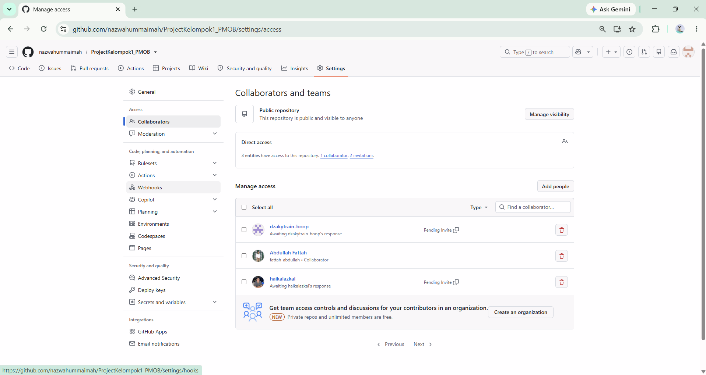
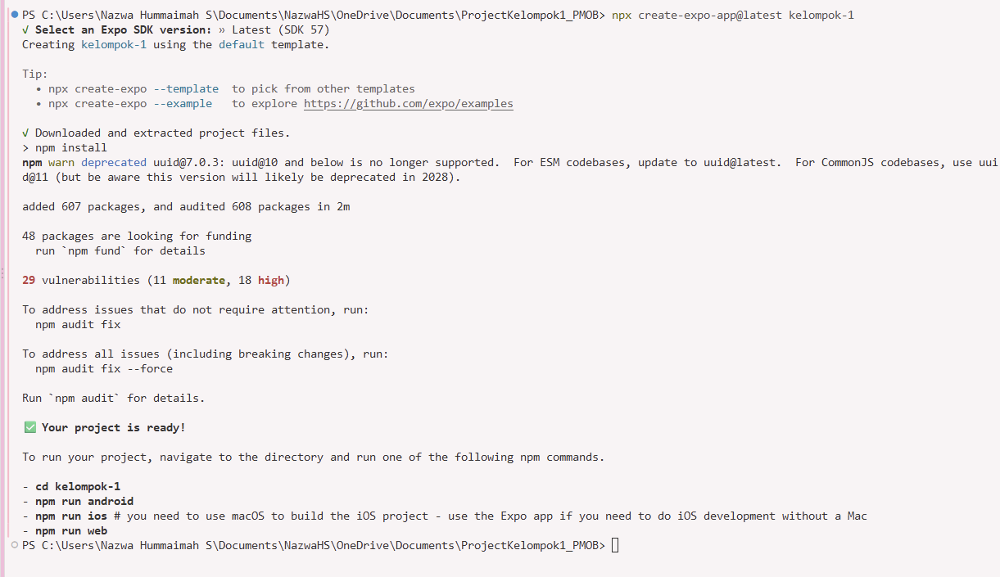
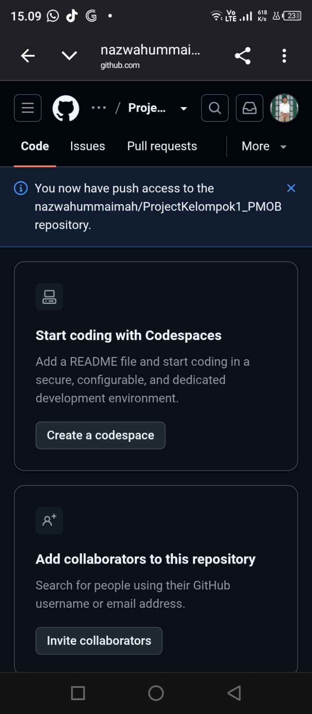
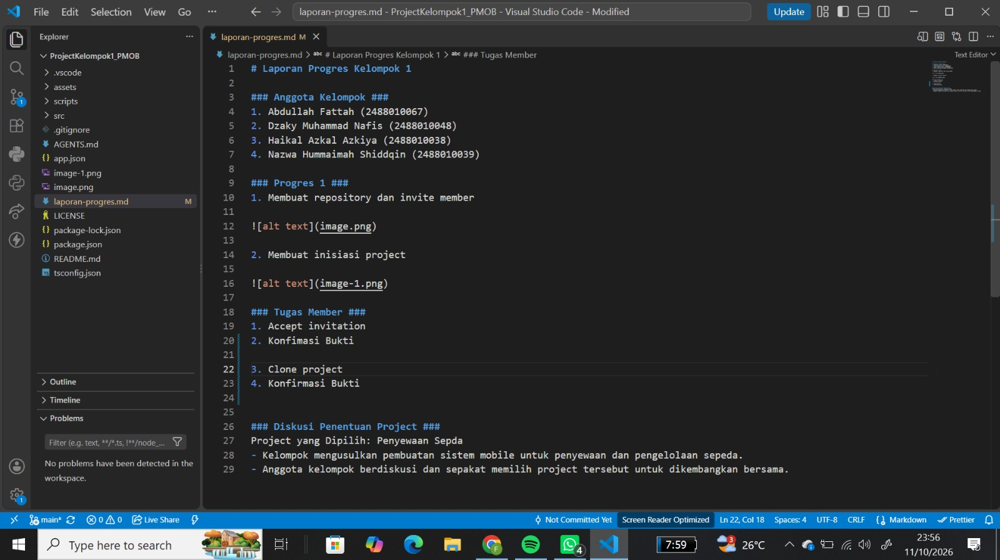
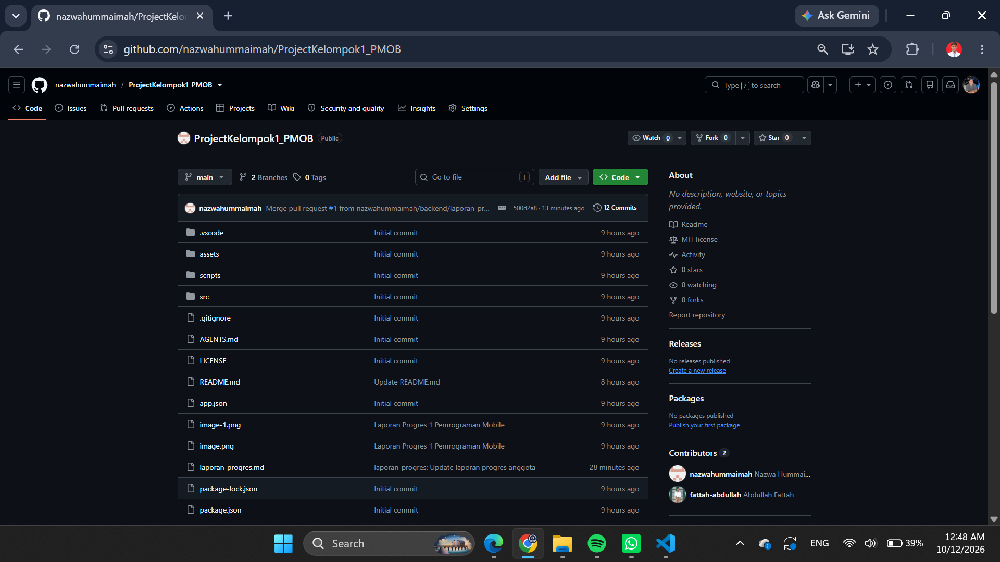
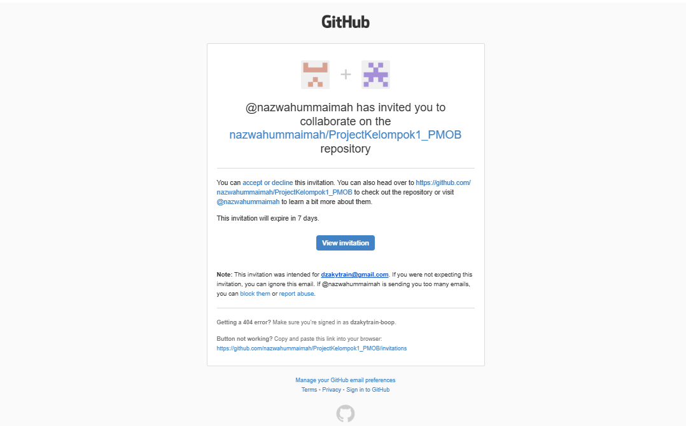
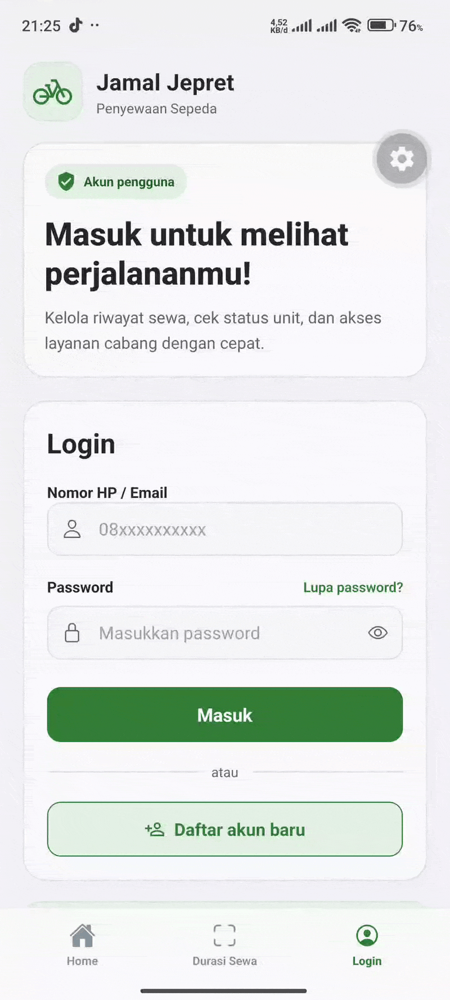
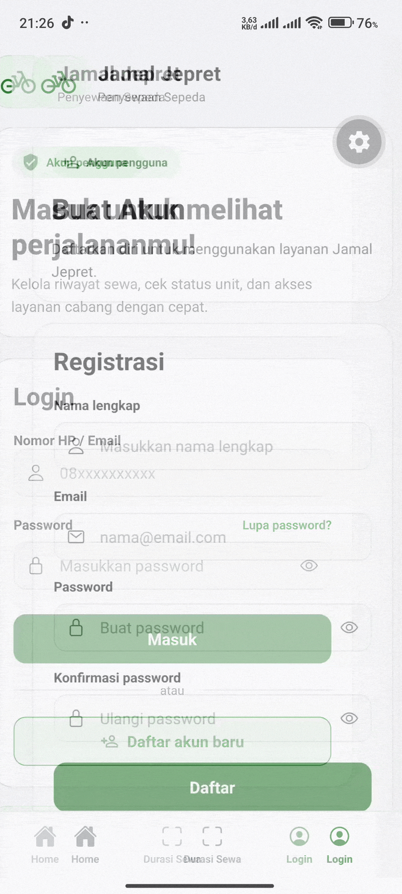
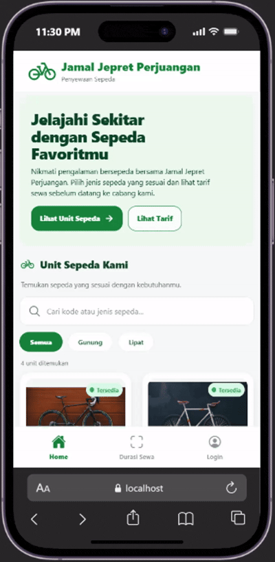

# Laporan Progres Kelompok 1 

### Anggota Kelompok ###
1. Abdullah Fattah (2488010067)
2. Dzaky Muhammad Nafis (2488010048)
3. Haikal Azkal Azkiya (2488010038)
4. Nazwa Hummaimah Shiddqin (2488010039)

## Progres 1 ##
1. Membuat repository dan invite member

2. Membuat inisiasi project

### Tugas Member 1 (Abdullah Fattah as Backend) ###
1. Accept invitation
2. Konfimasi Bukti

3. Clone project 
4. Konfirmasi Bukti

### Tugas Member 2 (Haikal Azkal Azkiya  as Frontend) ###
1. Accept invitation
2. Konfimasi Bukti

3. Clone project 
4. Konfirmasi Bukti

### Tugas Member 3 (Dzaky Muhammad Nafis as Frontend) ###
1. Accept invitation
2. Konfimasi Bukti

3. Clone project 
4. Konfirmasi Bukti

            
### Diskusi Penentuan Project ###
Project yang Dipilih: Penyewaan Sepda
- Kelompok mengusulkan pembuatan sistem mobile untuk penyewaan dan pengelolaan sepeda.
- Anggota kelompok berdiskusi dan sepakat memilih project tersebut untuk dikembangkan bersama.

## Progres 2 ##
### Pembagian Tugas ###

1. Abdullah Fattah
- Membuat tampilan halaman beranda/home
- Membuat tampilan splash-screen
- Konfimasi Bukti

2. Dzaky Muhammad Nafis
- Membuat tampilan halaman login
- Konfirmasi Bukti

- Membuat tampilan halaman register
- Konfirmasi Bukti

3. Haikal Azkal Azkiya 
- Membuat tampilan halaman durasi sewa
- Konfimasi Bukti

