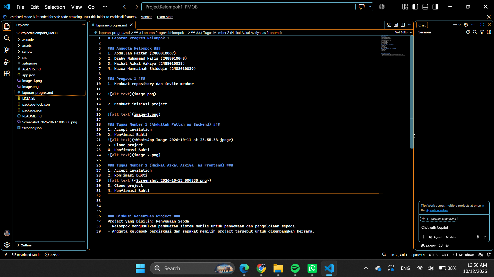
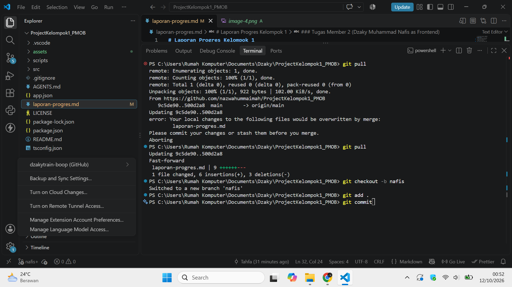

# Laporan Progres Kelompok 1 

### Anggota Kelompok ###
1. Abdullah Fattah (2488010067)
2. Dzaky Muhammad Nafis (2488010048)
3. Haikal Azkal Azkiya (2488010038)
4. Nazwa Hummaimah Shiddqin (2488010039)

### Progres 1 ###
1. Membuat repository dan invite member

2. Membuat inisiasi project

### Tugas Member 1 (Abdullah Fattah as Backend) ###
1. Accept invitation
2. Konfimasi Bukti

3. Clone project 
4. Konfirmasi Bukti

### Tugas Member 2 (Dzaky Muhammad Nafis as Frontend) ###
1. Accept invitation
2. Konfimasi Bukti

3. Clone project 
4. Konfirmasi Bukti

### Diskusi Penentuan Project ###
Project yang Dipilih: Penyewaan Sepda
- Kelompok mengusulkan pembuatan sistem mobile untuk penyewaan dan pengelolaan sepeda.
- Anggota kelompok berdiskusi dan sepakat memilih project tersebut untuk dikembangkan bersama.