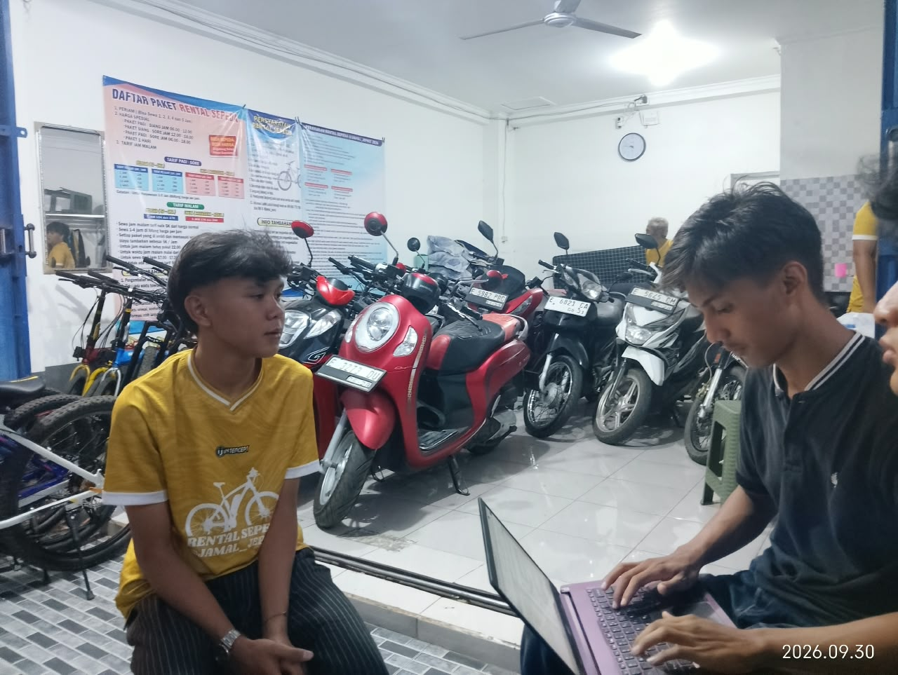
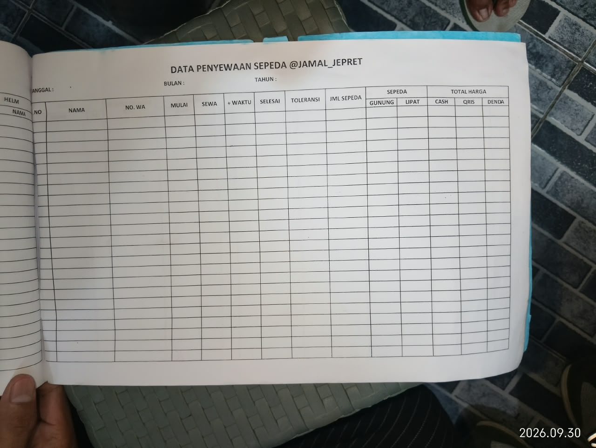

# Laporan Project Kelompok 1 

### Anggota Kelompok ###
1. Abdullah Fattah (2488010067)
2. Dzaky Muhammad Nafis (2488010048)
3. Haikal Azkal Azkiya (2488010038)
4. Nazwa Hummaimah Shiddqin (2488010039)

### Tema Project ###
Sistem Penyewaan Sepeda Jamal Jepret

Fitur Utama:
1. Halaman utama: menampilkan informasi sepeda, detail unit, ketersediaan sepeda, tarif dan paket sewa, serta informasi cabang.
2. Manajemen Akun: menyediakan registrasi dan login member serta login admin.
3. Pemantauan Durasi dan Riwayat Sewa: menampilkan durasi penyewaan yang sedang berlangsung dan riwayat sewa member.
4. Transaksi: mencatat dan mengelola transaksi penyewaan.
5. Inventaris: mengelola data dan status sepeda.

### Dokumentasi Wawancara ###

  

  

  

Notulensi:
1. Pencatatan transaksi penyewaan masih menggunakan buku manual dan staf terkadang lupa mencatat transaksi
2. Rental memiliki sekitar 62 unit sepeda di dua cabang. Ketersediaan sepeda masih mengandalkan ingatan staf dan  belum diperbarui melalui sistem secara langsung.
3. Penyewaan dilakukan langsung di lokasi tanpa pemesanan sebelumnya.
4. Data pelanggan yang dibutuhkan meliputi nama, nomor telepon, identitas sebagai jaminan, kategori pelanggan, paket sewa, unit sepeda, dan durasi penyewaan.
5. Tarif dibedakan berdasarkan kategori pelajar atau umum serta hari biasa atau hari libur
6. Pembayaran dilakukan menggunakan uang tunai atau QRIS sebelum sepeda digunakan.
7. Pemeriksaan pengembalian meliputi rantai, rem, ban, dan komponen perpindahan gigi. Kerusakan ringan tidak dikenai denda, sedangkan kerusakan berat dapat dikenai ganti rugi.
8. Jika keterlambatan pengembalian lebih dari dua jam, staf akan menghubungi pelanggan melalui telepon.
9. Perawatan sepeda dilakukan secara rutin oleh staf. Jika kerusakan tidak dapat diperbaiki sendiri, sepeda dibawa ke bengkel luar.
10. Rekap pendapatan masih dilakukan secara manual dan terkadang terjadi selisih antara catatan dengan uang yang diterima.
11. Pemilik membutuhkan laporan pendapatan harian dan bulanan serta pencatatan pengeluaran operasional.
12. Sistem diharapkan dapat membantu pencatatan transaksi, pengelolaan inventaris, pembaruan status sepeda, pencatatan pembayaran, dan pembuatan laporan.

### Pembagian Tugas ###

1. Abdullah Fattah
- Membuat tampilan halaman beranda
- Membuat tampilan splash-screen

2. Dzaky Muhammad Nafis
- Membuat tampilan halaman login
- Membuat tampilan halaman register

3. Haikal Azkal Azkiya 
- Membuat tampilan halaman durasi sewa

### Hasil Halaman ###

1. Splash-screen

2. Beranda

3. Durasi sewa

4. Login

5. Register

